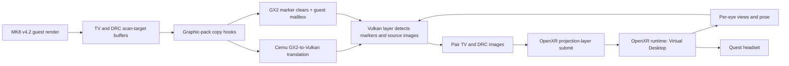

# Pipeline architecture

## Data path

## Guest layer

The graphic pack targets checksum `0x9F0A90B7` and installs a flow header in the Cemu codecave. The copy wrapper intercepts `GX2CopyColorBufferToScanBuffer` call sites and emits marker colors through `GX2ClearColor`. Markers identify eye and source target: TV target `1`, DRC target `4`. The pack also publishes/consumes pose state through a `CTPH` mailbox.

The documented copy sites are `0x0273951C`, `0x027AFD58`, and `0x027AFD78`. The target distinction permits the existing TV and DRC rendering paths to feed separate eye images.

## Host layer

The Cemu Vulkan layer observes `vkCmdClearColorImage` calls, decodes marker values, associates them with copied source images, and builds a stereo pair. It then acquires XR swapchain images and submits an OpenXR projection layer to Virtual Desktop.

The `XrCompositionLayerQuad` surface fallback caused a frozen image in the measured VD environment. The projection path is the proven working path. Settings that force the quad fallback should be treated as diagnostic only.

## Camera path

The render pass has a 4×4 projection matrix at record-context offset `+0`; it is uploaded at `0x026A5E98`. This is not the live game camera pose. The camera block found at `[camera]+0xD0` is copied in a 20-word block in static code, but counters at all known call sites stayed at zero in a live race.

The active camera/viewport update candidate is `FUN_024B0060`. Its per-target descriptors are stored in slots beginning at `param+0x890`, and it finalizes viewport rectangles/aspect through `FUN_024AEE78`, `FUN_024AF330`, `FUN_024AF7B4`, `FUN_024AF8F4`, and `FUN_024AFD28`. The actual live view matrix consumer remains to be traced.

## Two-eye strategy

The lowest-risk demonstrated strategy uses MK8’s existing TV and DRC renders as the two images. A full second scene draw remains a higher-risk alternative. It should only be pursued after verifying render-state side effects and distinct target buffers.

## Wire protocol notes

- `CTPH` is the pose mailbox; the host uses a seqlock-style publication check.
- Pose metadata uses magic float values and an encoded token. See research log §8.6.
- Eye markers identify source image and target.
- Both eyes must carry a matching pose publication/token for the host’s pose history to pair them.
- Extra guest `GX2ClearColor` calls caused a fail-fast in one experiment. The proven-safe marker path and the failed pose-token experiment are recorded separately; do not infer safety from protocol logic alone.

